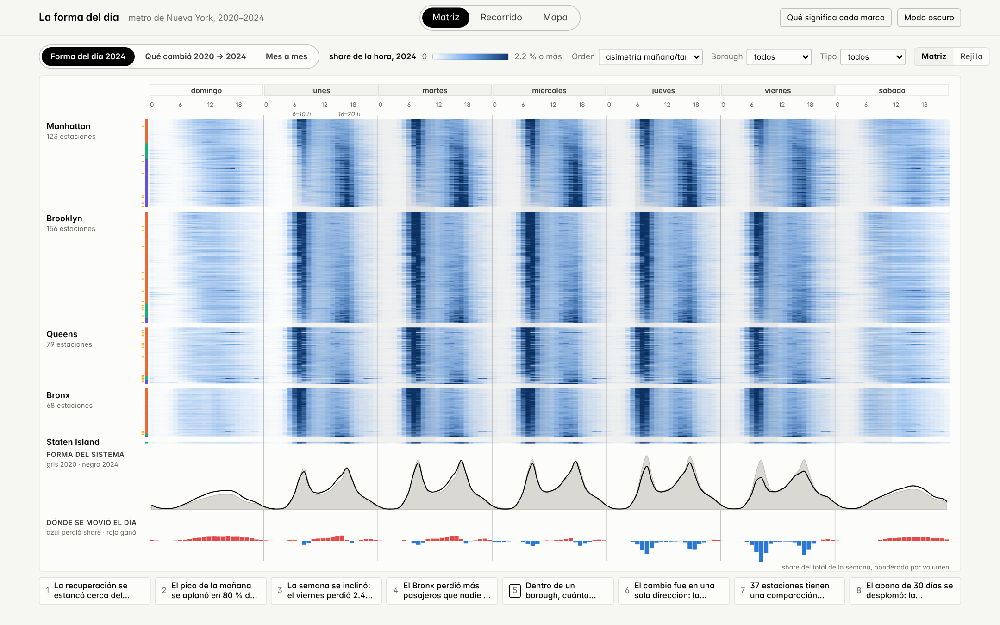
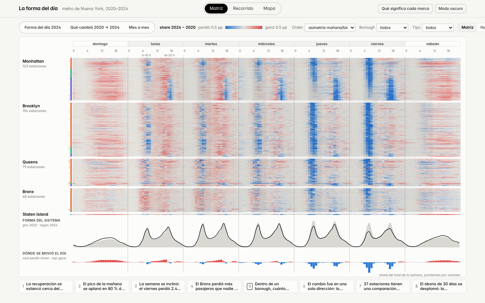
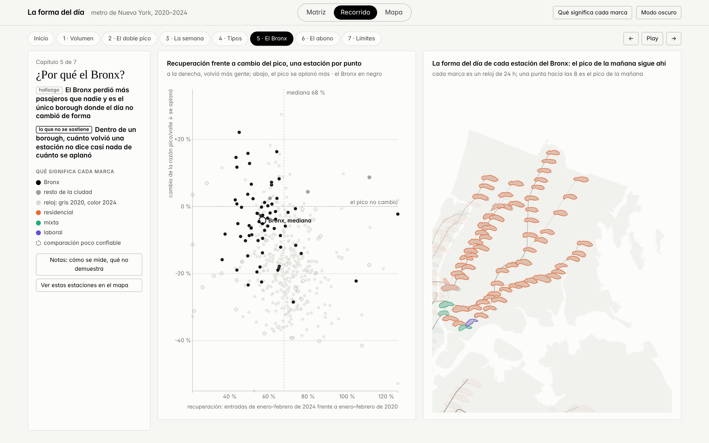
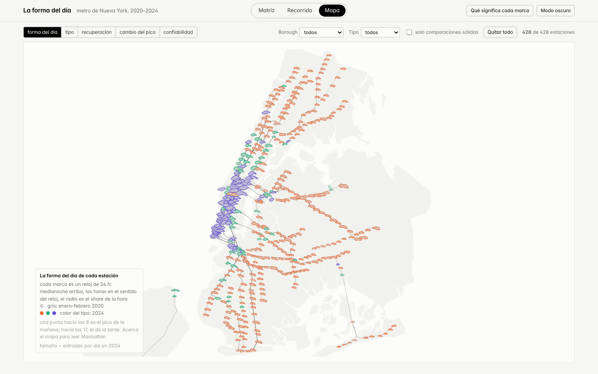

# Semana 10 — Prototipo funcional y design review

**DS5343 Data Visualization · UTEC · 2026-2** · entrega del 14 de octubre de 2026

Prototipo en D3.js de *La forma del día*: una aplicación de tres vistas — Matriz, Recorrido y Mapa — sobre los 428 complejos de estación del metro de Nueva York, 2020–2024.









---

## Contenido

| Archivo | Qué es |
|---|---|
| [`PrototypeReport.md`](PrototypeReport.md) | funcionalidades, decisiones de diseño, limitaciones y preguntas para los revisores |
| `PresentationWeek10.pptx` | presentación del design review |
| [`prototype/`](prototype/) | código fuente completo del prototipo |
| [`prototype/data/model.json`](prototype/data/model.json) · [`geo.json`](prototype/data/geo.json) | datos procesados que consume la aplicación (1.6 MB + 77 KB) |
| [`code/build_model.py`](code/build_model.py) | construye `model.json` desde las tablas de la Semana 6: 3 s, sin dependencias |
| [`code/build_geo.py`](code/build_geo.py) | construye `geo.json` desde GeoJSON de NYC y el GTFS de la MTA |
| [`code/datos_nuevos.ipynb`](code/datos_nuevos.ipynb) | notebook de Colab con las tres pasadas pendientes (ventana comparable del perfil, perfiles por mes, capa del Census) |
| [`guion-exposicion.md`](guion-exposicion.md) | guion del design review, cronometrado a 5 minutos |
| [`capturas/`](capturas/) | capturas del prototipo corriendo |

```
prototype/
├── index.html                 la aplicación: tres vistas + panel de evidencia + clave visual
├── src/
│   ├── tokens.css             sistema de diseño: colores por rol, tipografía; modo oscuro
│   ├── estilos.css
│   ├── main.js                carga datos, monta las tres vistas y el panel
│   ├── capitulos.js           los siete capítulos: pregunta, hallazgo, marcas, gráfico, notas, preset
│   ├── estado.js              estado compartido de las vistas
│   ├── panel-estacion.js      panel de evidencia de una estación
│   ├── util.js
│   └── graficos/              matriz · cinta · reloj · semana · tiras · pendiente · cortes · perfil · serie · mapa · dispersion · multiples · tarifas
├── data/model.json · geo.json
└── lib/d3.min.js              D3 v7.9.0
```

---

## Ejecución

No hay que instalar ni compilar nada. Hace falta un servidor HTTP porque usa módulos ES y `fetch`:

```bash
cd deliveries/week10/prototype
python3 -m http.server 8000
```

Abrir <http://localhost:8000>. Cualquier servidor estático sirve (`npx serve .`, `php -S localhost:8000`).

Pensado para 1 280 px o más de ancho; funciona en modo oscuro.

**Teclado:** `←` `→` entre capítulos (en Recorrido) · `Esc` cierra el panel y la clave visual.

---

## Cómo se lee

**Matriz** (vista base): las 428 estaciones como filas, agrupadas por borough, contra las 168 horas de la semana o los 60 meses. Tres lentes: forma del día 2024, qué cambió 2020 → 2024, mes a mes. Debajo, sincronizadas, la forma del sistema y dónde se movió el día (o las entradas y la composición tarifaria). Pasar el mouse muestra la estación y el valor; clic abre su evidencia; clic en un borough lo aísla. Los ocho hallazgos van abajo como chips; clic abre su capítulo.

**Recorrido**: siete capítulos como botones, con Play. A la izquierda, un panel angosto con la pregunta, el hallazgo y qué significa cada marca; el resto es el gráfico. Las notas (*cómo se mide*, *qué no demuestra*) se abren con un botón; otro abre el mapa ya configurado.

**Mapa**: las 428 estaciones a pantalla completa con cinco lentes; *forma del día* dibuja cada estación como un reloj de 24 h. Filtros por borough, tipo y confiabilidad. Clic en una estación → su panel de evidencia. La selección sobrevive al cambiar de vista.

El botón **"Qué significa cada marca"** de la barra abre la clave visual.

---

## Regenerar los datos

```bash
python3 deliveries/week10/code/build_model.py deliveries/week06/data/processed deliveries/week10/prototype/data/model.json
```

`build_model.py` acepta dos entradas opcionales que produce `datos_nuevos.ipynb` (`hourofweek_2024_enefeb.csv`, `acs_por_estacion.csv`); si están en la carpeta de entrada las usa y lo registra en `meta`. Las tablas de entrada se producen con los notebooks de la Semana 6 (ver el README raíz).

---

## Despliegue

Estático y con rutas relativas: funciona en GitHub Pages sin cambios.

1. **Settings → Pages** → *Deploy from a branch* → `main` → `/ (root)` → **Save**
2. Esperar uno o dos minutos.

```
https://stewartmb.github.io/data-visualization-2026-2/deliveries/week10/prototype/
```

La misma aplicación vive también en [`/app`](../../app/) (raíz del repositorio), que es la copia que sigue evolucionando hacia la Semana 12.

---

## Limitaciones

Documentadas en [`PrototypeReport.md`](PrototypeReport.md), sección 3. Las tres que más afectan la lectura: el perfil de 168 h de 2024 es todavía el año completo (la recuperación ya usa la misma ventana calendario); el brush temporal solo cambia el tamaño de las estaciones; la explicación del Bronx es una hipótesis consistente con los datos, no una medición.

---

Datos: Metropolitan Transportation Authority (MTA) vía Open NY · API SODA de Socrata. Geografía: NYC DCP y GTFS de la MTA. D3.js v7.9.0 (BSD-3-Clause). Parte del código se elaboró con asistencia de IA, revisada y validada por el equipo.
