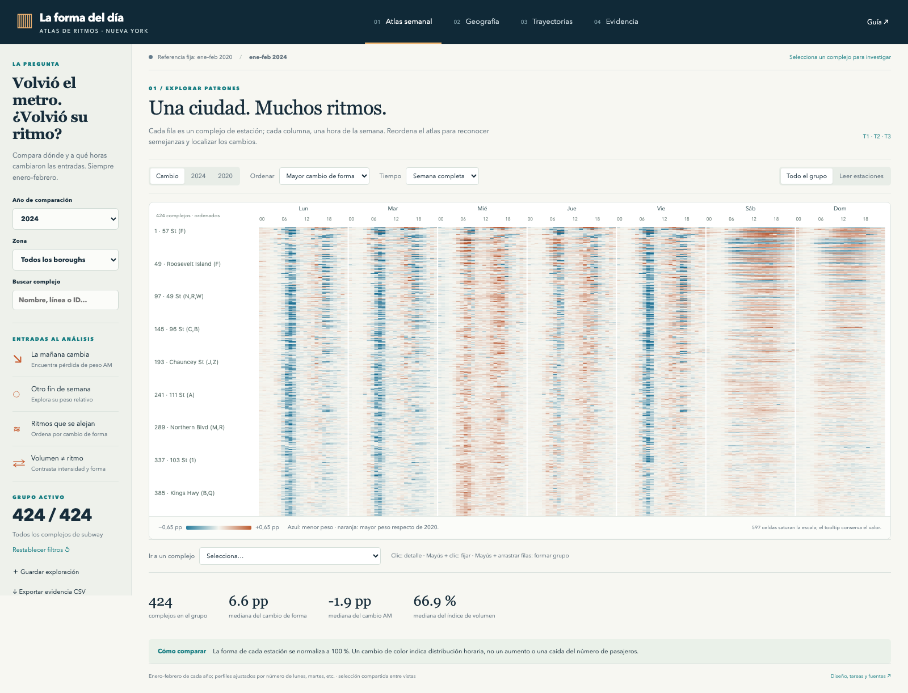
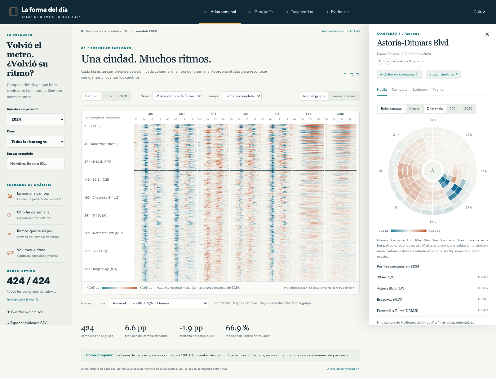
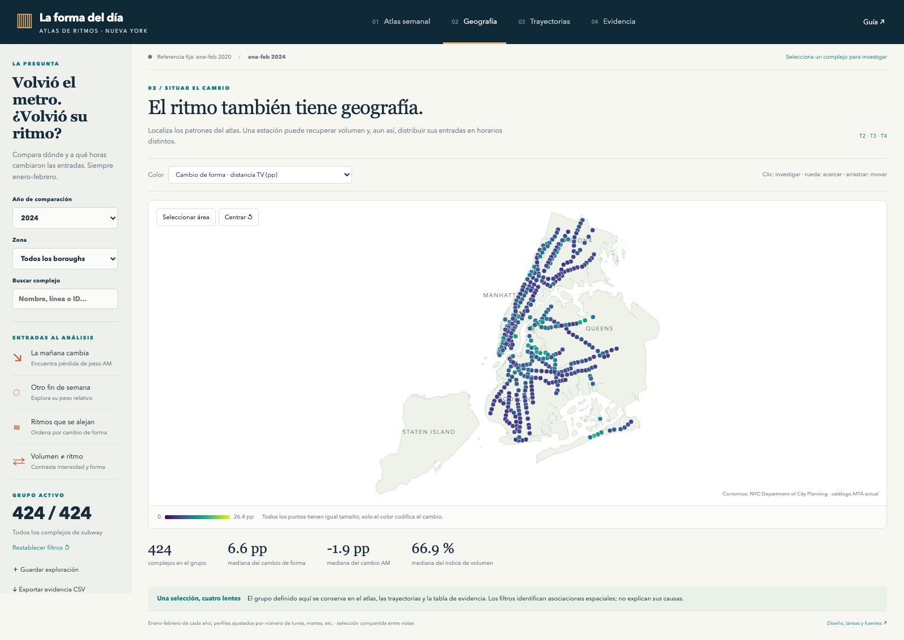
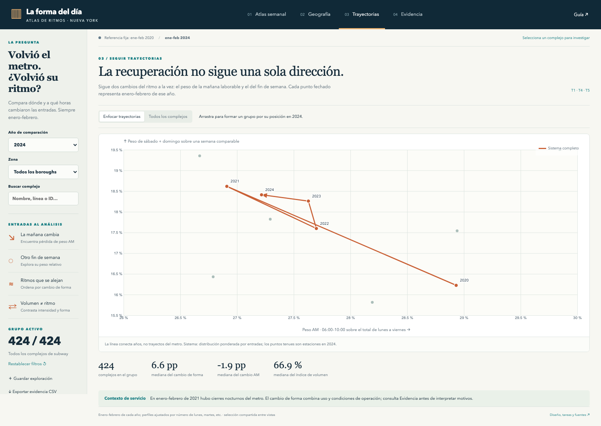

# Rediseño: La forma del día · Atlas de ritmos

Propuesta e implementación en la rama `codex/atlas-ritmos-urbanos`. La aplicación está en [`../atlas/`](../atlas/); el prototipo de Semana 10 se conserva como antecedente.

## Qué cambió

El problema se enfoca en investigar **cómo cambió la distribución horaria de las entradas al metro**, en qué complejos y cómo se relaciona ese cambio con el volumen. La aplicación permite encontrar patrones, compararlos, situarlos y documentarlos. La audiencia principal son analistas de transporte e investigadores urbanos; la secundaria, periodistas de datos. Apoyamos identificación de casos para investigar, sin prometer decisiones óptimas de frecuencia de trenes.

Se mantienen los datos horarios MTA y se incorporan tres aportes concretos:

1. Nuevas consultas de **enero–febrero en cada año 2020–2024**, para comparar la misma temporada.
2. Estandarización por cantidad de lunes, martes, etc., que evita confundir forma con composición del calendario.
3. Catálogo oficial de complejos MTA y contornos oficiales de boroughs DCP, para identidad y contexto geográfico.

El universo del nuevo atlas es **424 complejos de subway** en cuatro boroughs. Los 428 del prototipo anterior también incluían dos complejos SIR y dos de tram; se excluyen para mantener un modo consistente. El catálogo actual se une por ID exacto en 424/424 casos. No se agregaron personas sintéticas, flujos origen–destino ni relaciones causales inventadas.

## Aplicación implementada

- **Atlas semanal:** matriz estación × 168 horas; lectura de perfiles o diferencia explícita, orden por magnitud, geografía, volumen o similitud. Vista global y lectura ampliada con desplazamiento virtual. Una sola matriz trabaja con varias preguntas.
- **Geografía:** mapa con costa y boroughs, varias medidas de color, zoom y selección rectangular que forma un grupo compartido.
- **Trayectorias:** visualización temporal en un espacio de dos medidas —peso AM y fin de semana— con años, dirección, referencias y enfoque de las trayectorias seleccionadas.
- **Evidencia:** afirmaciones descriptivas calculadas sobre el grupo, tabla de medidas, fuentes y límites; exportación CSV y restauración de exploraciones guardadas.
- **Detalle bajo demanda:** huella cíclica de 168 sectores con equivalente matricial, comparación de perfiles, serie mensual contextual y trazabilidad. Se pueden fijar hasta tres complejos y buscar los 12 perfiles más cercanos a un ejemplo.

La selección, el año y los filtros se conservan al cambiar de vista y en la URL. Las exploraciones guardadas usan almacenamiento local del navegador. No se copiaron código ni recursos visuales de FINO: se adaptaron principios de navegación, contexto compartido y acceso a evidencia a un problema diferente.

## Ejecutar

Desde la raíz del repositorio:

```bash
python3 -m http.server 8765
```

Abrir **http://localhost:8765/atlas/**. No requiere compilación, tokens ni dependencias de red en tiempo de uso. D3 se sirve localmente. La consulta original a fuentes públicas ya está materializada en los archivos incluidos.

## Documentación para defender la propuesta

| Documento | Para qué sirve |
|---|---|
| [01-problema-y-tareas.md](01-problema-y-tareas.md) | Problema, audiencia, seis preguntas y tareas; entradas, salidas, vistas e interacciones |
| [02-investigacion-y-diseno.md](02-investigacion-y-diseno.md) | FINO, literatura, alternativas y justificación de cada representación |
| [03-datos-y-metodos.md](03-datos-y-metodos.md) | Fuentes, esquema, normalización, fórmulas, enriquecimientos y límites |
| [04-evaluacion.md](04-evaluacion.md) | Verificaciones técnicas y protocolo pendiente con personas |
| [data-audit.json](data-audit.json) | Auditoría numérica reproducible y huellas de archivos |

## Capturas de la implementación

Estas imágenes se obtienen del navegador con los datos incluidos; no son mockups de ImageGen.






## Estado y siguientes iteraciones

La rama ofrece un prototipo del rediseño, con sus objetivos y tareas reformulados. Antes de convertirlo en entrega final: realizar la crítica con personas, revisar las interpretaciones de casos extremos y controles de servicio, evaluar la lectura del reloj frente a la matriz y decidir qué hallazgos sostener en el paper. La calidad de uso y la calificación del docente no se dan por demostradas por tener código funcional.

El paper final, póster, videos y entrega final del curso siguen siendo trabajo separado. Las entregas históricas quedan como evidencia del proceso, con sus planteamientos originales.
